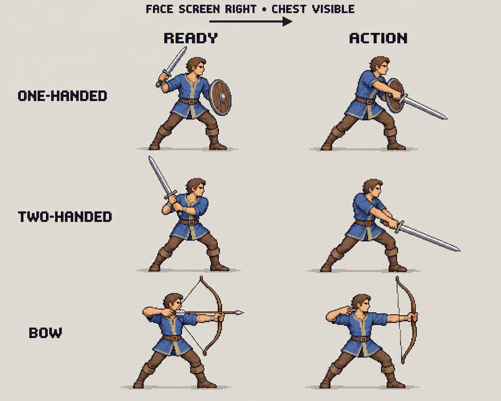

# Bipedal pose guide

**Status: awaiting user approval. Do not use as a production generation reference
until the user approves this exact image.** The written facing/pose requirements
were approved on 2026-10-17; approval of the illustration is separate.

This original illustration was generated with Codex's built-in image generator
on 2026-10-17 from [this exact prompt](prompt.txt), with no input images. It shows
one-handed melee, two-handed melee, and bow examples. It is a pose/camera guide,
not a character design to copy, and not a 128 x 128 game asset. Crossbows, slings
and thrusting weapons follow the written specification with weapon-appropriate
mechanics; do not substitute the sword/bow equipment shown here.

After explicit user approval, record `status: "approved"`, `approved_by` and
`approved_at` in [approval.json](approval.json). Keep `image_sha256` matched to
the approved PNG. Changing the image invalidates approval and requires review
again. Never mark it approved based only on the generator's self-review.

The [generation workflow](../../generation/README.md) supplies the authoritative
text rules, prompts, file checks and per-pair visual review requirements.
